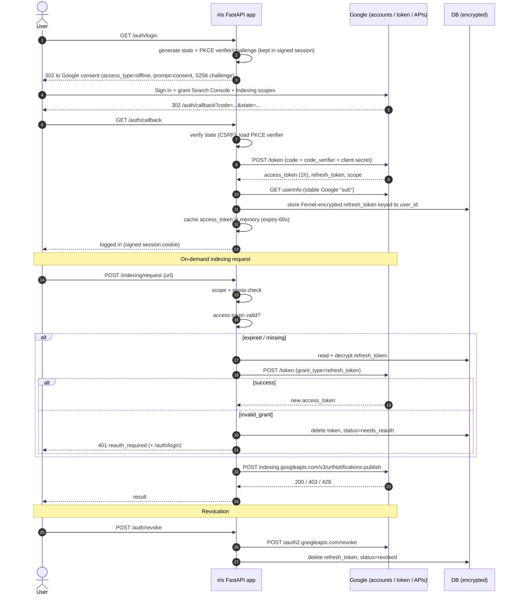
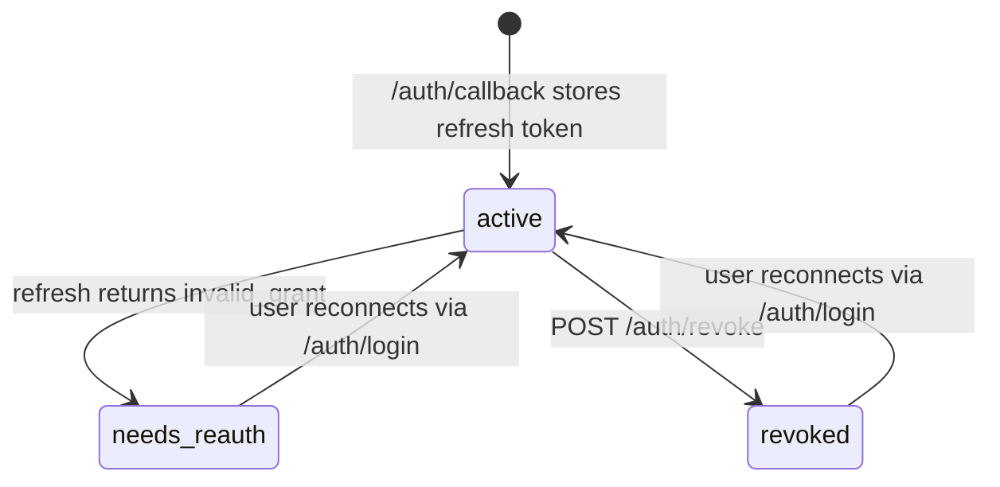

# iris-oauth-gsc — Google Search Console OAuth utility (FastAPI)

A FastAPI service implementing the full Google OAuth 2.0 lifecycle for Search Console: consent, token
exchange, encrypted storage, automatic refresh, revocation, dead-token handling, and on-demand URL
indexing notifications.

> **Read this first — the honest limitation.** Search Console's **"Request indexing"** button is **not
> exposed by any public API**. The URL Inspection API is read-only, and the Search Console API only lets
> you list sites and submit sitemaps. The only programmatic "please (re)crawl this URL" call is Google's
> **Indexing API**, which is **officially restricted to pages with `JobPosting` or `BroadcastEvent`
> (livestream) structured data**, requires the caller to be a **verified owner** of the property, and has
> a default quota of **200 publish requests/day** per project. This project implements the Indexing API
> call (`POST /indexing/request`) and is explicit about those constraints. For general pages the supported
> signals are sitemap submission (`POST /sitemaps`) and good internal linking.

---

## 1. Architecture at a glance

```
app/
  main.py          FastAPI app, session middleware, error handlers
  config.py        env settings + scopes
  auth.py          /auth/login, /auth/callback, /auth/status, /auth/revoke, /auth/logout
  tokens.py        encrypt/store, cache, refresh, invalid_grant handling, revoke
  crypto.py        Fernet (MultiFernet for key rotation)
  google_client.py Search Console / URL Inspection / Indexing API wrappers
  api.py           /sites, /inspection, /sitemaps, /indexing/request, /indexing/status
  db.py, models.py SQLAlchemy (SQLite by default, Postgres-ready)
tests/             14 tests, Google fully mocked
```

## 2. Full flow (sequence diagram)



### Connection state machine



---

## 3. Written walkthrough, step by step

### Step 0 — Google Cloud setup
1. Create a project; enable **Search Console API** and **Indexing API**.
2. Configure the **OAuth consent screen**. Set publishing status to **In production** (see the 7-day
   Testing-mode note below). Sensitive scopes need Google verification before real users can use the app.
3. Create an **OAuth client ID → Web application**, with `http://localhost:8000/auth/callback` (and your
   production URL) as authorized redirect URIs.
4. Copy `.env.example` → `.env` and fill it in.

### Step 1 — Authorization request (`GET /auth/login`)
The app generates:
- **`state`** — random, stored in the signed session cookie, compared on callback → prevents CSRF /
  login-injection.
- **PKCE** `code_verifier` (kept server-side in the session) and `code_challenge = BASE64URL(SHA256(verifier))`
  with method `S256`. PKCE binds the code to the browser that started the flow, so an intercepted code is
  useless. It is recommended even for confidential clients.
- `access_type=offline` → Google will issue a **refresh token**.
- `prompt=consent` → forces the consent screen, because Google only returns a refresh token on the *first*
  consent for a user/client pair unless you force it.
- Scopes: `openid email` (stable user identity), `.../auth/webmasters` (Search Console),
  `.../auth/indexing` (Indexing API). `include_granted_scopes=true` for incremental authorization.

### Step 2 — Callback and token exchange (`GET /auth/callback`)
1. Reject if Google sent `error`, or `state` does not match (constant-time compare).
2. POST the `code` + `code_verifier` + client credentials to `https://oauth2.googleapis.com/token`.
3. Receive `access_token` (~1 hour), `refresh_token`, granted `scope`.
4. Call userinfo to get the Google `sub`, upsert our `User`, so tokens are tied to a **user ID**, not a
   session.
5. If no refresh token came back (user previously consented and prompt was skipped), we keep the existing
   one if still active; otherwise we tell the user to remove the app at
   `myaccount.google.com/permissions` and reconnect.

### Step 3 — Token storage
| Token | Where | How |
|---|---|---|
| Refresh token | DB (`google_connections.encrypted_refresh_token`) | **Fernet (AES-128-CBC + HMAC-SHA256)**, never plaintext, never logged |
| Access token | In-process cache keyed by `user_id` | short-lived (~1h), **never persisted**; use Redis if you run multiple workers |
| Granted scopes, status, last_error | DB | for diagnostics and re-auth prompts |

`TOKEN_ENCRYPTION_KEYS` is a comma-separated list handled by `MultiFernet`: the first key encrypts, all
keys decrypt. **Key rotation** = prepend a new key, run `crypto.rotate()` over rows, then drop the old
key. In production the key should come from a KMS/secret manager.

### Step 4 — Refresh (`tokens.get_access_token`)
Before **every** Google API call:
1. Cached access token still valid (with a 60 s safety margin)? Use it.
2. Otherwise take a **per-user lock** (so two concurrent requests don't both refresh), re-check the cache,
   decrypt the refresh token, and `POST grant_type=refresh_token`.
3. Success → cache the new access token (and store a rotated refresh token if Google sent one).
4. If Google answers an API call with **401**, force **one** refresh and retry once.
5. **Refresh failure handling is deliberately split:**
   - `invalid_grant` → the refresh token is dead. Delete it, set `status=needs_reauth`, return
     `401 {"error":"reauth_required","reauth_url":"/auth/login"}`.
   - Network error / 5xx → return 503/502 and **keep** the token (transient problems must not log users out).
   - `invalid_client` → our misconfiguration, 500, token kept.

### Step 5 — Revocation
**App-initiated (`POST /auth/revoke`):** call `https://oauth2.googleapis.com/revoke` with the refresh token
(revoking the refresh token invalidates its access tokens too), then delete the stored token and set
`status=revoked` **even if Google's call fails** (the user asked us to forget them).

**User-initiated at Google** (`myaccount.google.com/permissions` → Remove access): Google does not call us.
We discover it lazily — the next refresh returns `invalid_grant`, and the same `needs_reauth` path runs.
Already-issued access tokens may keep working for up to ~1 hour. For immediate detection in production, use
**Cross-Account Protection (RISC)** event notifications, which Google can push to you on token revocation,
account disablement, etc.

### Step 6 — What happens when the user changes their Google password?
Short answer: **for this app's scopes, usually nothing — the refresh token keeps working, but you must be
ready for it not to.**

- Google's documented behaviour: a refresh token is **invalidated on password change only when it contains
  Gmail scopes**. Search Console / Indexing scopes are not Gmail scopes, so a standard consumer password change
  does **not** revoke our token.
- Things that *do* cause `invalid_grant` (and therefore the re-auth flow):
  - User removes the app's access in their Google Account.
  - **Google Workspace admin policy**: session-length controls / reauthentication policies, restricted
    third-party app access, or admin revoking tokens (this is the realistic "password reset" case for company
    accounts — admins resetting a user and signing them out can kill tokens).
  - Account suspended/deleted, or security events (compromised-account remediation).
  - **6 months of inactivity** of the refresh token.
  - **Token cap:** a user can hold at most **100 refresh tokens per Google account per client ID**; the oldest
    is silently invalidated when exceeded (this is why `prompt=consent` on every login should be reserved
    for users without a working token, as a production optimization).
  - OAuth consent screen in **Testing** status: refresh tokens expire after **7 days**.
  - Clock/secret problems or reuse of a rotated token.
- **Our behaviour is the same regardless of cause:** catch `invalid_grant` → delete the dead token → mark
  `needs_reauth` → API returns a structured 401 with `reauth_url` → UI shows "Reconnect Google". No data loss,
  and no retry loops against a dead token.

### Step 7 — Requesting indexing on demand (`POST /indexing/request`)
```bash
curl -X POST localhost:8000/indexing/request \
  -H 'content-type: application/json' --cookie "session=..." \
  -d '{"url": "https://example.com/jobs/123", "type": "URL_UPDATED"}'
```
What is checked / done:
1. Logged in, connection `active`, **`indexing` scope actually granted** (users can untick scopes under
   granular consent).
2. Local **quota guard** (default 200/day, project-wide, from the `indexing_log` table) → 429 when reached.
3. Valid access token (refresh path above) → `POST https://indexing.googleapis.com/v3/urlNotifications:publish`.
4. `403` is translated into a clear message: the user must be a **verified owner** of the Search Console
   property and the Indexing API must be enabled.
5. Every attempt is logged (audit + quota accounting). `GET /indexing/status?url=` returns Google's
   notification metadata.

**Constraints (stated plainly):**
| Option | Can it "request indexing"? | Notes |
|---|---|---|
| Search Console UI "Request indexing" | Yes | **Not available via API** |
| URL Inspection API (`POST /inspection`) | No | read-only index status |
| Sitemaps API (`POST /sitemaps`) | Indirectly | supported general crawl signal |
| **Indexing API** (`POST /indexing/request`) | Yes, but only | `JobPosting` / `BroadcastEvent` pages; owner required; 200/day default; no indexing guarantee |

Using the Indexing API on other page types is against Google's documented policy and may stop working or
risk the project; do not market it as a general "force index" feature.

---

## 4. Run it

```bash
python -m venv .venv && source .venv/bin/activate
pip install -r requirements.txt
cp .env.example .env     # fill in client id/secret, generate the two secrets
uvicorn app.main:app --reload
# open http://localhost:8000/auth/login, then http://localhost:8000/docs
pytest -q
```

Endpoints: `GET /auth/login` · `GET /auth/callback` · `GET /auth/status` · `POST /auth/revoke` ·
`POST /auth/logout` · `GET /sites` · `POST /inspection` · `POST /sitemaps` · `POST /indexing/request` ·
`GET /indexing/status`

## 5. Production checklist
- HTTPS everywhere, `HTTPS_ONLY_COOKIES=true`; consider `SameSite=Lax` + CSRF tokens on state-changing POSTs.
- Keys in a KMS / secret manager; scheduled key rotation via `MultiFernet`.
- Redis for the access-token cache and **distributed per-user locks** when running multiple workers
  (current locks are per process).
- Postgres + Alembic migrations (the app uses `create_all` for convenience).
- Rate-limit `/auth/*` and `/indexing/request` per user; queue indexing calls with backoff on 429.
- Log events and user IDs, **never** tokens, codes, or authorization headers.
- Subscribe to Google **Cross-Account Protection (RISC)** for push notification of revocation.
- Background job to find `needs_reauth` connections and notify users; periodic health check of refresh tokens
  for inactive users to avoid the 6-month expiry.
- Complete Google's OAuth app verification for sensitive scopes and move consent screen to *In production*.

## 6. Design decisions
- **Sync httpx + SQLAlchemy** in FastAPI's threadpool: simple, easy to reason about locking.
- **Session cookie** (signed) holds only `user_id` + transient OAuth `state`/PKCE verifier; tokens never go
  to the browser.
- **Per-user connection row** with an explicit status makes "what happened to my token" observable.
